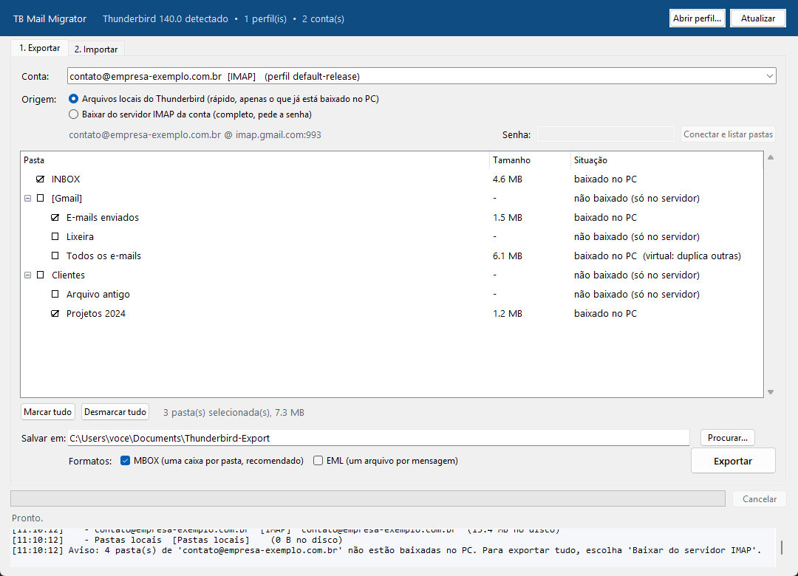
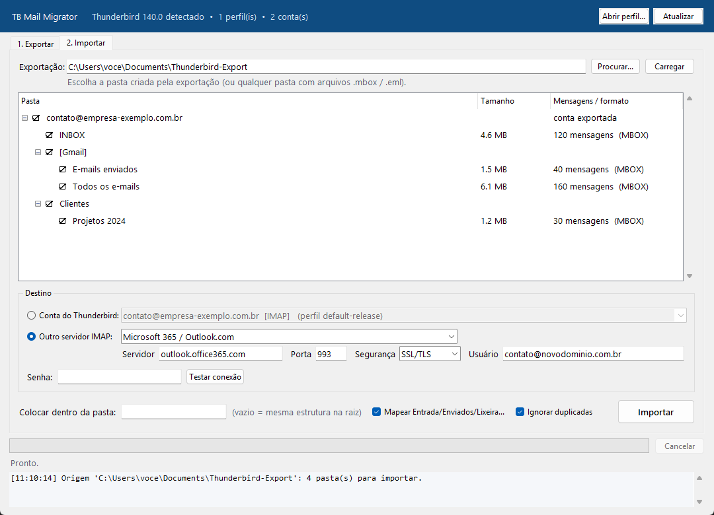
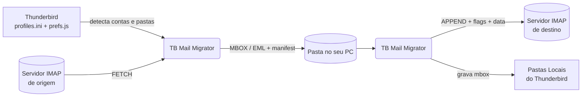

<div align="center">


# TB Mail Migrator

**Exporte caixas de e-mail do Mozilla Thunderbird para o seu PC e importe em qualquer outra conta, com poucos cliques.**

[](https://github.com/marco3079/tb-mail-migrator/releases/latest)


[](LICENSE)

</div>

---

## Visão geral

O **TB Mail Migrator** é um aplicativo para Windows (um único `.exe`, sem instalação) que:

1. **Detecta automaticamente** o Thunderbird instalado, os perfis, as contas e todas as pastas de e-mail;
2. **Exporta** as pastas escolhidas para o disco em formatos abertos (**MBOX** e/ou **EML**);
3. **Importa** essa exportação para outra caixa: qualquer servidor **IMAP** (Gmail, Microsoft 365, Yahoo, iCloud, Zoho, servidores próprios) ou as **Pastas Locais** do Thunderbird.

Serve para trocar de provedor, fazer backup antes de cancelar uma conta, consolidar caixas ou arquivar e-mails antigos fora do servidor.

<p align="center">
  
  
</p>

## Funcionalidades

| | |
|---|---|
| 🔍 **Detecção automática** | Lê o registro do Windows, o `profiles.ini` e o `prefs.js` para achar a instalação, os perfis e as contas (IMAP, POP3, Pastas Locais), sem nenhuma configuração. |
| 🗂️ **Seleção por pasta** | Árvore com caixas de seleção, tamanho e situação de cada pasta. Marcar uma pasta marca as subpastas. |
| 💾 **Duas origens de exportação** | **Arquivos locais**: lê direto o cache do Thunderbird (rápido, funciona offline). **Servidor IMAP**: baixa tudo do servidor, incluindo pastas que o Thunderbird nunca sincronizou. |
| 📦 **Formatos abertos** | MBOX (uma caixa por pasta, padrão de mercado) e EML (um arquivo por mensagem, abre em qualquer cliente). Um `manifest.json` registra a estrutura original. |
| 📤 **Importação via IMAP** | Recria a árvore de pastas no destino e preserva **data original**, **lida/não lida**, **respondida** e **com estrela**. |
| 🧭 **Mapeamento inteligente** | Entrada, Enviados, Rascunhos, Lixeira, Spam e Arquivo são enviados para as pastas equivalentes do destino (por SPECIAL-USE, RFC 6154, ou pelo nome em PT/EN). Prefixos como `[Gmail]/` são removidos. |
| ♻️ **Sem duplicatas e retomável** | Compara o `Message-ID` com o que já existe no destino. Se a importação parar no meio, é só rodar de novo. |
| 🔌 **Resiliente** | Reconecta sozinho em quedas de rede, processa arquivos de vários GB em streaming e permite cancelar a qualquer momento. |
| 🔒 **Privado** | Nada sai do seu PC, a não ser para o servidor que você mesmo escolher. Senhas não são gravadas em lugar nenhum. |

## Download e uso rápido

1. Baixe o **`TBMailMigrator.exe`** na página de [Releases](https://github.com/marco3079/tb-mail-migrator/releases/latest) e execute-o (não precisa instalar).
2. Na aba **1. Exportar**:
   - escolha a **conta**;
   - escolha a **origem** (*arquivos locais* ou *servidor IMAP*, que pede a senha e depois **Conectar e listar pastas**);
   - marque as pastas, escolha onde salvar e clique em **Exportar**.
3. Na aba **2. Importar** (a exportação recém-feita já vem carregada):
   - marque as pastas;
   - escolha o destino: uma **conta do Thunderbird** ou **outro servidor IMAP** (há atalhos para os provedores mais comuns);
   - digite a senha, clique em **Testar conexão** e depois em **Importar**.

> [!NOTE]
> O Windows SmartScreen pode avisar sobre "editor desconhecido", porque o executável não é assinado digitalmente. Clique em **Mais informações → Executar assim mesmo**, ou gere o seu próprio `.exe` a partir do código-fonte (veja abaixo).

## Dicas importantes

### Arquivos locais × servidor IMAP
Em contas IMAP, o Thunderbird costuma guardar no PC só **parte** das pastas. As que aparecem como *"não baixado (só no servidor)"* existem apenas no servidor. Para uma cópia **completa**, use a origem **"Baixar do servidor IMAP"**.

### Gmail e Google Workspace
- O login por IMAP exige uma **[senha de app](https://myaccount.google.com/apppasswords)** (é preciso ter a verificação em duas etapas ativada). A senha normal da conta não funciona.
- `Todos os e-mails`, `Importante` e `Com estrela` são **pastas virtuais**: repetem mensagens de outras pastas. Por isso já vêm desmarcadas. Marque **`Todos os e-mails`** só se quiser também as mensagens arquivadas sem marcador.
- O Gmail limita a transferência por IMAP a cerca de 2,5 GB de download e 500 MB de upload por dia. Em caixas grandes, a importação pode ser interrompida pelo servidor; basta rodar de novo no dia seguinte, porque as duplicadas são ignoradas.

### Microsoft 365 / Outlook.com
A Microsoft desativou a autenticação básica (usuário + senha) por IMAP na maioria dos tenants. Se o login falhar, importe para uma conta do Thunderbird já configurada com OAuth: exporte para MBOX e use **Pastas Locais** como destino; depois arraste as pastas para a conta no Thunderbird.

### Importar para as Pastas Locais do Thunderbird
**Feche o Thunderbird** antes. O app grava os arquivos MBOX direto no perfil e apaga o índice (`.msf`) da pasta, para que o Thunderbird a reconstrua na próxima abertura.

## Estrutura da exportação

```text
Thunderbird-Export-2026-11-09/
└── contato@empresa.com.br/
    ├── manifest.json            ← conta, origem, pastas e contagens
    ├── mbox/
    │   ├── INBOX.mbox
    │   ├── [Gmail]/E-mails enviados.mbox
    │   └── Clientes/Projetos 2024.mbox
    └── eml/                     ← (opcional) uma mensagem por arquivo
        └── INBOX/000001 - Assunto da mensagem.eml
```

Os arquivos `.mbox` também podem ser abertos por outras ferramentas (por exemplo, o complemento *ImportExportTools NG* do Thunderbird, o Apple Mail ou o `mutt`).

## Como funciona



| Módulo | Responsabilidade |
|---|---|
| [`thunderbird.py`](src/tbmigrator/thunderbird.py) | Localiza a instalação e lê perfis, contas e a árvore de pastas (mbox e maildir). |
| [`mbox.py`](src/tbmigrator/mbox.py) | Leitor/gravador MBOX em streaming, flags `X-Mozilla-Status`, cabeçalhos e datas. |
| [`imapconn.py`](src/tbmigrator/imapconn.py) | Cliente IMAP sobre o `imaplib`, com reconexão automática e nomes de pasta em UTF-7 modificado. |
| [`exporter.py`](src/tbmigrator/exporter.py) | Exporta dos arquivos locais ou do servidor e gera o `manifest.json`. |
| [`importer.py`](src/tbmigrator/importer.py) | Lê a exportação e envia para o IMAP ou grava nas Pastas Locais. |
| [`gui.py`](src/tbmigrator/gui.py) | Interface Tkinter, com as tarefas rodando em segundo plano. |

O aplicativo usa **apenas a biblioteca padrão do Python**, sem dependências de terceiros em tempo de execução.

## Executar a partir do código-fonte

Requisitos: Windows 10/11 e Python 3.10 ou superior.

```powershell
git clone https://github.com/marco3079/tb-mail-migrator.git
cd tb-mail-migrator
$env:PYTHONPATH = "src"
python -m tbmigrator
```

### Testes

```powershell
python tests\test_core.py -v
```

A suíte inclui um **servidor IMAP falso em memória**, que testa a exportação e a importação de ponta a ponta sem tocar em contas reais.

### Gerar o executável

```powershell
powershell -ExecutionPolicy Bypass -File build.ps1
# saída: dist\TBMailMigrator.exe
```

O workflow em [`.github/workflows/build.yml`](.github/workflows/build.yml) roda os testes e gera o `.exe` automaticamente a cada tag `v*`, anexando o arquivo ao Release.

## Logs

Cada operação fica registrada em `%LOCALAPPDATA%\TBMailMigrator\logs\migrator-AAAAMMDD.log`. As senhas nunca são registradas.

## Limitações conhecidas

- Login OAuth2 (Google/Microsoft) ainda não é suportado; use senha de app ou o caminho pelas Pastas Locais.
- Marcadores/tags coloridas do Thunderbird (`X-Mozilla-Keys`) não são convertidos em keywords IMAP.
- Contatos, calendários e filtros não fazem parte da migração (só e-mails).

## Roadmap

- [ ] Login OAuth2 para Gmail e Microsoft 365
- [ ] Filtro por intervalo de datas
- [ ] Modo linha de comando para agendar backups
- [ ] Exportar contatos (`.vcf`) e calendários (`.ics`)

## Contribuindo

Issues e pull requests são bem-vindos. Antes de abrir um PR, rode `python tests\test_core.py`.

## Licença

Distribuído sob a licença [MIT](LICENSE).

<sub>Thunderbird é marca registrada da Mozilla Foundation. Este projeto é independente e não tem vínculo com a Mozilla.</sub>
